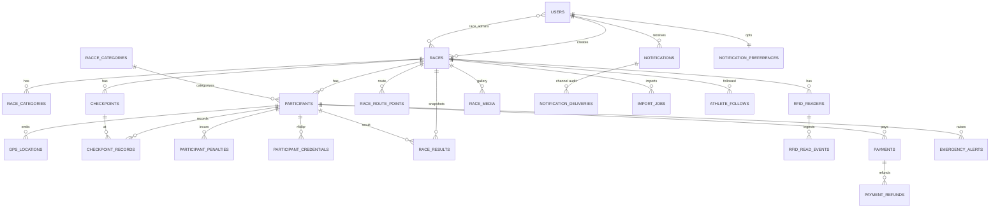

# Entity-relationship overview

Core domain (abridged; see Flyway migrations for the authoritative schema).

Notes:

- `race_results` is the published-results snapshot (`UNIQUE(participant_id, race_id)`); reads
  for published races serve it, otherwise results are computed from checkpoint records.
- `notification_deliveries` records one row per (notification, channel) with status
  `SENT`/`SKIPPED`/`FAILED`.
- `checkpoint_records.is_cutoff_missed` marks late reads; `races.completed_at` records verified
  completion.
- `gps_locations` is the highest-volume table; retention is age-based and partitioning on
  `recorded_at` is planned as an operations migration.
